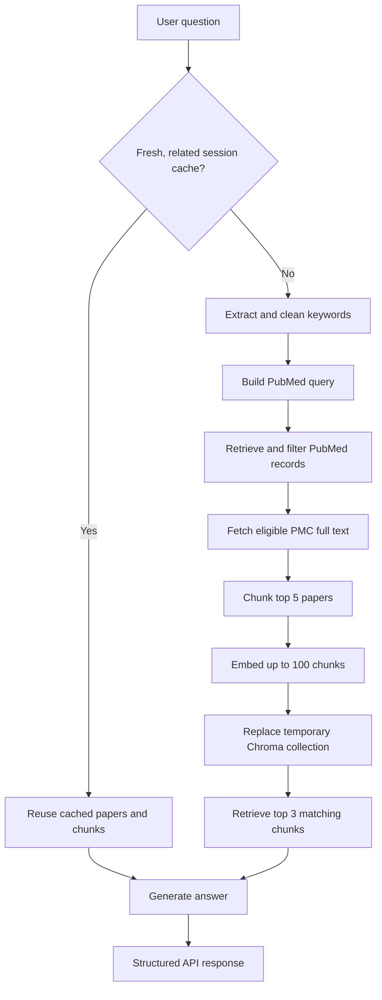
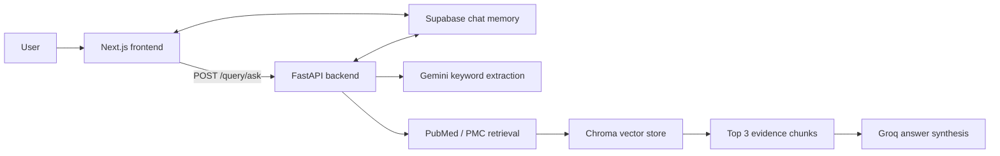

# MedInsight

MedInsight is a clinical-literature research assistant. A Next.js interface accepts a medical research question, while a FastAPI service extracts search concepts, retrieves relevant PubMed/PMC literature, selects the most relevant evidence with retrieval-augmented generation (RAG), and produces a concise synthesis.

> **Clinical-use notice:** MedInsight is a research-support tool, not a diagnostic, treatment, or emergency-care service. Outputs can be incomplete or incorrect and must be reviewed against the cited source material and by an appropriately qualified professional.

## What it does

- Accepts an initial clinical/research query and multi-turn follow-up questions.
- Uses Gemini for structured keyword extraction, with a local deterministic fallback if Gemini is unavailable.
- Searches PubMed by relevance and enriches eligible records with open-access PMC full-text paragraphs where available.
- Filters unusable metadata and excludes comments, editorials, letters, news, and newspaper articles.
- Chunks and embeds evidence in Chroma, retrieves the three nearest chunks, and asks Groq to produce a grounded answer.
- Reuses a recent session’s evidence context for related follow-up questions to avoid unnecessary searches.
- Stores browser chat history in session storage and can persist chat history/cache data in Supabase.

## Functionalities used

| Functionality | How it works in MedInsight | Why it is useful |
| --- | --- | --- |
| Clinical-query interface | The Next.js landing page accepts a free-text research question and opens a dedicated continuation chat after the first answer. | Gives users a simple research-first workflow rather than exposing raw search parameters. |
| Input validation | FastAPI/Pydantic requires a non-empty `query`, validates `max_results` between 1 and 20, and returns a `400` response for invalid input. | Stops malformed requests before external APIs or models are called. |
| Keyword extraction | Gemini is prompted to return a small JSON list of medical concepts; the result is normalized, deduplicated, stripped of generic phrases, and limited to eight terms. | Turns conversational language into focused terms that PubMed can search effectively. |
| Offline keyword fallback | If Gemini, its key, or its JSON response is unavailable, a local regex-based extractor keeps useful phrases and removes common filler words. | The literature-search workflow still works when the keyword model is unavailable. |
| PubMed retrieval | Biopython’s NCBI Entrez client searches PubMed by relevance, then fetches article metadata and abstracts. | Brings current, structured biomedical literature into the workflow. |
| Evidence quality filtering | Records without a PMID, title, or abstract are removed, as are comments, editorials, letters, news, and newspaper articles. | Reduces low-value or non-research material before RAG ingestion. |
| PMC enrichment | When an article has a PMCID, the backend fetches open-access PMC XML and extracts meaningful body paragraphs. | RAG can use fuller evidence than an abstract when it is legally/publicly available. |
| Vector retrieval | Article text is chunked, embedded, stored in Chroma, and searched using similarity search. | Selects the small amount of evidence most relevant to the actual question. |
| Grounded answer synthesis | Groq receives the question plus retrieved chunks, titles, and PubMed URLs, with instructions to use only supplied context. | Produces readable research summaries while reducing unsupported claims. |
| Follow-up chat | The frontend sends up to five recent question/answer pairs with each follow-up; the backend also reads stored history when configured. | Lets requests such as “summarize that” retain the prior topic. |
| Topic-aware caching | A session cache stores the source query, vector, keywords, papers, and retrieved chunks for a configurable TTL. Topic overlap, similarity, and a topic-shift check decide whether it can be reused. | Makes relevant follow-ups faster and avoids repeating PubMed and embedding work. |
| Resilient storage | Chat history falls back to browser `sessionStorage`; RAG cache persistence falls back to in-process memory when Supabase is unavailable. | The core experience degrades gracefully rather than failing because optional persistence is offline. |

## Core concepts

### Retrieval-augmented generation (RAG)

An LLM can write fluent answers, but its built-in knowledge does not automatically contain the specific articles returned for a user’s question. RAG supplies relevant external text to the model at answer time. In this project, PubMed and PMC are the evidence source, Chroma finds the closest passages, and Groq writes an answer from those passages.

RAG has two distinct jobs:

1. **Retrieval** finds evidence: retrieve articles, split them into chunks, convert chunks and the user query to numerical vectors, then choose the nearest chunks.
2. **Generation** explains evidence: give the model the user’s question and only those retrieved chunks, then instruct it to synthesize rather than invent information.

This separation matters because literature retrieval can be refreshed independently of the answer model, and the response can be traced back to the selected paper metadata and PubMed URLs.

### Keywords and search queries

Keywords are concise medical concepts, such as a condition, therapy, biomarker, or outcome. They are not the final answer. MedInsight uses them to construct a PubMed expression where the first keyword is the primary concept and later keywords are alternatives. It also requires abstracts and boosts common research publication types. For example, the terms `GLP-1 agonists`, `obesity`, and `diabetes` become a primary-treatment term combined with an obesity/diabetes group, instead of a broad natural-language search.

### Chunks

A chunk is the smallest retrievable unit of evidence. MedInsight makes one chunk per useful PMC paragraph. If an open-access full text is not available, it splits a structured PubMed abstract into labelled sections where possible, otherwise it uses the abstract as one chunk. Every chunk retains metadata including article title, PMID/PMCID, journal, DOI, source URLs, paper rank, and whether its text came from PMC full text or a PubMed abstract.

### Embeddings and similarity search

An embedding is a list of numbers representing text for comparison. MedInsight embeds documents as `retrieval_document` and questions as `retrieval_query`, then Chroma performs a similarity search to identify relevant chunks.

By default, the project uses a deterministic, normalized 384-dimension hashing vector based on text tokens. It is local, free, and reliable as an offline fallback, but it is primarily lexical and is less semantically capable than a trained biomedical embedding model. With `USE_GEMINI_EMBEDDINGS=true`, the application requests Gemini embeddings instead; if that call fails, it automatically returns to the local embedding implementation.

### Grounding, provenance, and fallback answers

For answers with retrieved chunks, the prompt tells Groq to use only the supplied PubMed context and not to invent citations, statistics, studies, or clinical facts. The prompt includes each chunk’s paper title and PubMed URL, preserving source provenance in the model context.

If no chunks are retrieved, MedInsight switches to a separate fallback prompt that asks for well-established medical knowledge, requires disclosure that retrieval did not produce relevant context, and prohibits fabricated citations. This is a helpful continuity mechanism, but it is not a retrieved-evidence answer and should be interpreted accordingly.

### Cache, session, and topic shift

A **session** identifies a browser chat. A **cache record** stores the latest successful retrieval context for that session: its source question, embedding, keywords, topic terms, PubMed query, papers, and retrieved chunks. The default cache lifetime is three hours.

Before a follow-up causes a new search, the backend checks whether the cache is fresh and whether the new question is about the same topic. It uses meaningful term overlap, vector cosine similarity, keyword overlap, follow-up wording, and—when Gemini is available—a JSON topic-shift classification. A related question can reuse the prior evidence; a question that changes disease, therapy, drug class, organ system, or research area starts a new retrieval flow.

## How RAG is implemented

The end-to-end RAG orchestration lives in `backend/rag/langchain_pipeline.py`. It builds a LangChain sequence of four stages: prepare context, retrieve PubMed evidence, refresh/retrieve vectors, and generate an answer.



### 1. Prepare context and decide whether to reuse evidence

`run_medinsight_chain()` first merges the history supplied by the browser with any Supabase chat history, removing duplicate questions. For a session with a fresh cache, it asks whether the new request remains on the same topic. If it does, the pipeline bypasses keyword extraction, PubMed, and Chroma retrieval and uses the saved chunks. If it does not, or if no valid cache exists, the pipeline starts a new search.

This is evidence-context reuse, not answer reuse: the model still generates a new answer for the user’s new wording. If a related follow-up has no chunks but there is prior chat text, the project instead uses the most recent answer as tightly constrained conversation context—for example, to reformat it as bullets.

### 2. Retrieve source literature

For fresh requests, `process_user_query()` runs Gemini keyword extraction and cleaning. `build_pubmed_query()` builds a quoted query with an abstract requirement and a publication-type group. `fetch_pubmed_papers()` requests a relevance-ordered candidate list, fetches article details, filters unsuitable records, and limits the final set to the requested maximum (10 by default).

The backend then attempts to enrich papers that have a PMCID by downloading PMC XML and retaining useful body paragraphs. Articles without accessible PMC text are still valuable: their abstracts become the fallback source for chunking.

### 3. Build document chunks and vectors

`chunk_pubmed_papers()` considers the first five retrieved papers for RAG. It prefers their full-text PMC paragraphs and otherwise uses abstract sections. Each resulting chunk gets a stable ID such as `pubmed-<pmid>-chunk-<number>` plus source metadata.

`refresh_pubmed_collection()` clears the configured temporary Chroma collection before writing a fresh query’s material. It passes at most `MAX_STORED_CHUNKS` chunks (100 by default) to LangChain’s Chroma store. During indexing, document chunks are embedded; during search, the user’s question is embedded using the query task type.

### 4. Retrieve the most relevant evidence

`retrieve_similar_chunks()` performs Chroma similarity search with `top_k=3`. The returned objects include the chunk text, metadata, stable ID, and similarity score/distance returned by Chroma. These are emitted in the `/query/ask` response as `retrieved_chunks`, which makes the evidence selected by the pipeline inspectable by the client.

The vector collection is intentionally temporary: a new fresh search replaces the previous collection. The durable, per-session layer is the optional Supabase cache, which preserves only the chunks selected for that session’s answer. In a shared deployment, separate collection names or stronger tenant isolation are needed if simultaneous users must never share a temporary vector collection.

### 5. Generate a grounded response

`generate_answer()` serializes the three retrieved chunks into a prompt containing the question, article title, PubMed URL, and chunk text. Its primary prompt says to rely only on that context, explain uncertainty naturally, avoid fabricated citations, and choose a readable structure appropriate to the question.

When retrieval is empty, `_ensure_answer_fallback()` and `generate_answer()` route to a fallback prompt rather than pretending that a literature-grounded answer exists. If Groq cannot generate a response, the API returns an error instead of silently manufacturing output.

### RAG design choices and trade-offs

| Choice | Benefit | Trade-off |
| --- | --- | --- |
| PubMed/PMC as sources | Focuses the system on biomedical literature and preserves article identifiers/URLs. | Not every article has accessible full text; retrieval coverage depends on NCBI availability. |
| Paragraph-level chunks | Lets the retriever select precise passages instead of whole papers. | Context can omit information from other parts of a study. |
| Top five papers indexed, top three chunks generated | Keeps latency and prompt size manageable. | Important evidence outside those limits can be missed. |
| Temporary Chroma refresh | Prevents stale documents from accumulating in the active collection. | A shared collection needs isolation for concurrent multi-user production use. |
| Local hash embeddings by default | Enables local/offline execution without another paid model dependency. | It is weaker at meaning-based retrieval than trained embeddings. |
| Cached related follow-ups | Faster and less expensive multi-turn chat. | A weak topic-shift decision can reuse context that is too broad or too narrow. |
| Fallback knowledge mode | Gives the user a useful reply when retrieval fails. | It is not evidence-grounded in the current PubMed result and must be labelled as such. |

## Architecture



### Query lifecycle

1. The landing page creates a new session and submits the user’s query to `POST /query/ask`.
2. The backend determines whether the query is a follow-up related to cached evidence. Related queries can reuse a fresh cache; a topic shift triggers a fresh search.
3. For a fresh search, Gemini returns up to eight medical keywords. If that call fails, local phrase extraction keeps the pipeline operational.
4. The backend builds a PubMed query requiring an abstract and favoring clinical trials, reviews, meta-analyses, randomized controlled trials, and journal articles.
5. PubMed metadata and optional PMC full text are chunked, embedded, written to Chroma, and searched for the most relevant three chunks.
6. Groq synthesizes the response from retrieved evidence. If no usable retrieval context exists, the service uses its configured fallback answer path.
7. The frontend displays the answer, stores it locally, and sends its last five turns with later follow-up requests.

## Repository layout

```text
.
├── backend/
│   ├── main.py                 # FastAPI application and HTTP routes
│   ├── query_engine/           # Gemini/local keyword extraction
│   ├── search/fetch.py         # PubMed + PMC retrieval and parsing
│   └── rag/                    # Chunking, embeddings, Chroma, cache, synthesis
├── frontend/
│   ├── app/                    # Next.js landing and chat pages
│   ├── utils/                  # Supabase client and browser chat memory
│   ├── scripts/dev-with-backend.js
│   └── supabase/chat_memory.sql
├── config.py                   # Shared environment-driven configuration
├── requirements.txt            # Python dependencies
├── Dockerfile                  # Hugging Face Spaces backend image
└── vercel.json                 # Root-level Vercel configuration
```

## Tech stack

| Area | Implementation |
| --- | --- |
| Web app | Next.js 16, React 18, Tailwind CSS |
| API | FastAPI, Pydantic, Uvicorn |
| LLMs | Gemini (keywords/optional embeddings), Groq (answer synthesis) |
| Retrieval | LangChain, ChromaDB, local hash embeddings or Gemini embeddings |
| Literature sources | NCBI Entrez via Biopython: PubMed and PMC |
| Session persistence | Supabase and browser storage |
| Deployment | Vercel frontend and Hugging Face Docker Space backend |

## Prerequisites

- Python 3.11 or later
- Node.js 20 or later
- A Gemini API key for LLM keyword extraction (local extraction is used when unavailable)
- A Groq API key for answer generation
- A real contact email for NCBI/Entrez use
- Optional: Supabase project and Chroma Cloud credentials

## Local development

### 1. Configure environment variables

Create a project-root `.env` file. `config.py` also reads `backend/.env` and `frontend/.env.local`; existing process environment variables take effect for deployments.

```dotenv
# Required for full LLM behavior
GEMINI_API_KEY=...
GROQ_API_KEY=...
PUBMED_EMAIL=you@example.com

# Frontend-to-backend URL (put this in frontend/.env.local for Next.js)
NEXT_PUBLIC_API_BASE_URL=http://127.0.0.1:8000

# Optional PubMed configuration
PUBMED_API_KEY=...
PUBMED_TOOL_NAME=medinsight
PUBMED_TIMEOUT_SECONDS=20

# Optional Supabase persistence
NEXT_PUBLIC_SUPABASE_URL=https://your-project.supabase.co
NEXT_PUBLIC_SUPABASE_PUBLISHABLE_KEY=...
SUPABASE_SERVICE_KEY=...

# Optional Chroma Cloud; omit all three to use local Chroma storage
CHROMA_API_KEY=...
CHROMA_TENANT=...
CHROMA_DATABASE=...
CHROMA_COLLECTION_NAME=medinsight_temp_pubmed_chunks

# Optional RAG tuning
USE_GEMINI_EMBEDDINGS=false
CHROMA_LOCAL_PATH=chroma
MAX_STORED_CHUNKS=100
MEDINSIGHT_CACHE_TTL_SECONDS=10800
```

Never commit credentials or a populated `.env` file.

### 2. Install dependencies

```powershell
python -m venv .venv
.\.venv\Scripts\Activate.ps1
pip install -r requirements.txt

cd frontend
npm ci
```

### 3. Run the application

From the repository root, start the API:

```powershell
uvicorn backend.main:app --host 127.0.0.1 --port 8000 --reload
```

In a second terminal, start the frontend:

```powershell
cd frontend
npm run dev:next
```

Open the URL printed by Next.js (normally `http://localhost:3000`).

Alternatively, `npm run dev` from `frontend/` starts Next.js and, when necessary, starts a backend on port `8000`. Set `KEEP_EXISTING_BACKEND=1` if you want it to leave a running backend untouched.

## API reference

FastAPI exposes interactive OpenAPI documentation at `/docs` while the backend is running.

| Method and path | Purpose |
| --- | --- |
| `GET /health` | Returns `{"status":"ok"}` when the API is reachable. |
| `POST /query/keywords` | Tests keyword extraction only. |
| `POST /search/pubmed` | Fetches and stores PubMed evidence for supplied keywords. |
| `POST /query/ask` | Runs the complete query → retrieval → RAG-answer workflow. |

### `POST /query/ask`

Request fields:

| Field | Type | Notes |
| --- | --- | --- |
| `query` | string | Required, non-empty medical research question. |
| `session_id` | string | Optional stable chat identifier used for cache reuse. |
| `max_results` | integer | Optional, 1–20; default `10`. |
| `conversation_history` | array | Optional prior `{ "query", "answer" }` turns; frontend supplies up to five. |

Example:

```bash
curl -X POST http://127.0.0.1:8000/query/ask \
  -H "Content-Type: application/json" \
  -d '{"query":"What does recent evidence say about GLP-1 receptor agonists for obesity?","session_id":"demo-session","max_results":10}'
```

The response includes the normalized query, extracted/cleaned keywords, generated PubMed query, paper metadata, retrieved chunks, and the synthesized `answer`.

### Supporting endpoints

```bash
curl -X POST http://127.0.0.1:8000/query/keywords \
  -H "Content-Type: application/json" \
  -d '{"query":"Recent evidence for metformin in polycystic ovary syndrome"}'

curl -X POST http://127.0.0.1:8000/search/pubmed \
  -H "Content-Type: application/json" \
  -d '{"keywords":["GLP-1 agonists","obesity"],"max_results":5}'
```

## Supabase setup

To persist chat history and the backend’s evidence cache, execute [`frontend/supabase/chat_memory.sql`](frontend/supabase/chat_memory.sql) in the Supabase SQL editor. It creates:

- `medinsight_chat_memory`: browser chat messages keyed by session ID.
- `medinsight_chat_cache`: backend cache records containing prior query context, papers, and retrieved chunks.

### Important security note

The included SQL intentionally creates permissive anonymous read/insert/update policies. That is convenient for a prototype but is **not appropriate for sensitive, patient, or production user data**: anyone with the public project credentials can potentially access rows. Before production, replace these policies with authenticated, user-scoped policies and avoid placing any service-role key in browser-accessible variables.

## Deployment

### Backend: Hugging Face Spaces

The first five lines of this file are Hugging Face Space metadata. The supplied root `Dockerfile` uses Python 3.11, installs `requirements.txt`, runs `uvicorn backend.main:app`, and exposes port `7860`. It also defaults local Chroma storage to `/tmp/medinsight-chroma`.

1. Create a Hugging Face Space using the **Docker** SDK and push this repository.
2. Set `app_port` to `7860` (already declared in this README metadata).
3. Add Space secrets as applicable:

   - `GEMINI_API_KEY`
   - `GROQ_API_KEY`
   - `PUBMED_EMAIL` and optionally `PUBMED_API_KEY`
   - `CHROMA_API_KEY`, `CHROMA_TENANT`, `CHROMA_DATABASE` for Chroma Cloud
   - `SUPABASE_URL` and `SUPABASE_SERVICE_KEY` if backend cache persistence is enabled

4. Verify the deployed service:

```bash
curl https://your-backend-space.hf.space/health
```

### Frontend: Vercel

Import the repository into Vercel. Either leave the project root at the repository root (the root `vercel.json` changes into `frontend/`) or set Vercel’s Root Directory to `frontend` (which has its own `vercel.json`).

Set these Vercel environment variables:

```dotenv
NEXT_PUBLIC_API_BASE_URL=https://your-backend-space.hf.space
NEXT_PUBLIC_SUPABASE_URL=https://your-project.supabase.co
NEXT_PUBLIC_SUPABASE_PUBLISHABLE_KEY=...
```

Use `npm run build` when `frontend/` is the root, or `cd frontend && npm run build` from the repository root.

## Storage and caching behavior

- A fresh PubMed search replaces the configured temporary Chroma collection. The collection is shared unless separate deployment/configuration is used.
- Chroma uses local persistent storage when Cloud credentials are absent. Container-local data is ephemeral on many hosts, including typical Spaces restarts.
- By default, embeddings are local 384-dimensional deterministic hash vectors. Set `USE_GEMINI_EMBEDDINGS=true` to use Gemini embeddings instead.
- A session cache defaults to a three-hour TTL. It stores evidence only after useful chunks are retrieved; cache persistence failures do not stop a response.
- The frontend continues to work without Supabase by using browser `sessionStorage`; persistence then lasts only for that browser session.

## Operational notes and limitations

- PubMed/PMC availability, rate limits, and article access determine what can be retrieved. `PUBMED_EMAIL` should always identify the calling application/contact.
- A retrieved paper is not a guarantee of clinical validity, applicability, recency, or peer-review quality. Review source links and study design before use.
- CORS currently permits all origins, which is convenient for deployment but should be restricted to known frontend domains for production.
- The API returns HTTP `400` for invalid request data and `500` for pipeline/storage/model failures. PubMed retrieval failures are logged and may yield an answer without retrieved chunks.
- No automated test suite or CI workflow is currently present in this repository; validate the API health check, a keyword request, a full query, and `npm run build` before release.

## Useful commands

```powershell
# Backend health check
curl http://127.0.0.1:8000/health

# Frontend production build
cd frontend
npm run build

# Start frontend production server after build
npm run start
```
