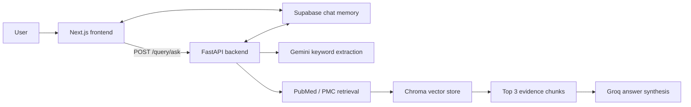

# MedInsight

MedInsight is a clinical-literature research assistant. A Next.js interface accepts a medical research question, while a FastAPI service extracts search concepts, retrieves relevant PubMed/PMC literature, selects the most relevant evidence with retrieval-augmented generation (RAG), and produces a concise synthesis.

> **Clinical-use notice:** MedInsight is a research-support tool, not a diagnostic, treatment, or emergency-care service. Outputs can be incomplete or incorrect and must be reviewed against the cited source material and by an appropriately qualified professional.

## What it does

- Accepts an initial clinical/research query and multi-turn follow-up questions.
- Uses Gemini for structured keyword extraction, with a local deterministic fallback if Gemini is unavailable.
- Searches PubMed by relevance and enriches eligible records with open-access PMC full-text paragraphs where available.
- Filters unusable metadata and excludes comments, editorials, letters, news, and newspaper articles.
- Chunks and embeds evidence in Chroma, retrieves the three nearest chunks, and asks Groq to produce a grounded answer.
- Reuses a recent session’s evidence context for related follow-up questions to avoid unnecessary searches.
- Stores browser chat history in session storage and can persist chat history/cache data in Supabase.

## Architecture



### Query lifecycle

1. The landing page creates a new session and submits the user’s query to `POST /query/ask`.
2. The backend determines whether the query is a follow-up related to cached evidence. Related queries can reuse a fresh cache; a topic shift triggers a fresh search.
3. For a fresh search, Gemini returns up to eight medical keywords. If that call fails, local phrase extraction keeps the pipeline operational.
4. The backend builds a PubMed query requiring an abstract and favoring clinical trials, reviews, meta-analyses, randomized controlled trials, and journal articles.
5. PubMed metadata and optional PMC full text are chunked, embedded, written to Chroma, and searched for the most relevant three chunks.
6. Groq synthesizes the response from retrieved evidence. If no usable retrieval context exists, the service uses its configured fallback answer path.
7. The frontend displays the answer, stores it locally, and sends its last five turns with later follow-up requests.

## Repository layout

```text
.
├── backend/
│   ├── main.py                 # FastAPI application and HTTP routes
│   ├── query_engine/           # Gemini/local keyword extraction
│   ├── search/fetch.py         # PubMed + PMC retrieval and parsing
│   └── rag/                    # Chunking, embeddings, Chroma, cache, synthesis
├── frontend/
│   ├── app/                    # Next.js landing and chat pages
│   ├── utils/                  # Supabase client and browser chat memory
│   ├── scripts/dev-with-backend.js
│   └── supabase/chat_memory.sql
├── config.py                   # Shared environment-driven configuration
├── requirements.txt            # Python dependencies
├── Dockerfile                  # Hugging Face Spaces backend image
└── vercel.json                 # Root-level Vercel configuration
```

## Tech stack

| Area | Implementation |
| --- | --- |
| Web app | Next.js 16, React 18, Tailwind CSS |
| API | FastAPI, Pydantic, Uvicorn |
| LLMs | Gemini (keywords/optional embeddings), Groq (answer synthesis) |
| Retrieval | LangChain, ChromaDB, local hash embeddings or Gemini embeddings |
| Literature sources | NCBI Entrez via Biopython: PubMed and PMC |
| Session persistence | Supabase and browser storage |
| Deployment | Vercel frontend and Hugging Face Docker Space backend |

## Prerequisites

- Python 3.11 or later
- Node.js 20 or later
- A Gemini API key for LLM keyword extraction (local extraction is used when unavailable)
- A Groq API key for answer generation
- A real contact email for NCBI/Entrez use
- Optional: Supabase project and Chroma Cloud credentials

## Local development

### 1. Configure environment variables

Create a project-root `.env` file. `config.py` also reads `backend/.env` and `frontend/.env.local`; existing process environment variables take effect for deployments.

```dotenv
# Required for full LLM behavior
GEMINI_API_KEY=...
GROQ_API_KEY=...
PUBMED_EMAIL=you@example.com

# Frontend-to-backend URL (put this in frontend/.env.local for Next.js)
NEXT_PUBLIC_API_BASE_URL=http://127.0.0.1:8000

# Optional PubMed configuration
PUBMED_API_KEY=...
PUBMED_TOOL_NAME=medinsight
PUBMED_TIMEOUT_SECONDS=20

# Optional Supabase persistence
NEXT_PUBLIC_SUPABASE_URL=https://your-project.supabase.co
NEXT_PUBLIC_SUPABASE_PUBLISHABLE_KEY=...
SUPABASE_SERVICE_KEY=...

# Optional Chroma Cloud; omit all three to use local Chroma storage
CHROMA_API_KEY=...
CHROMA_TENANT=...
CHROMA_DATABASE=...
CHROMA_COLLECTION_NAME=medinsight_temp_pubmed_chunks

# Optional RAG tuning
USE_GEMINI_EMBEDDINGS=false
CHROMA_LOCAL_PATH=chroma
MAX_STORED_CHUNKS=100
MEDINSIGHT_CACHE_TTL_SECONDS=10800
```

Never commit credentials or a populated `.env` file.

### 2. Install dependencies

```powershell
python -m venv .venv
.\.venv\Scripts\Activate.ps1
pip install -r requirements.txt

cd frontend
npm ci
```

### 3. Run the application

From the repository root, start the API:

```powershell
uvicorn backend.main:app --host 127.0.0.1 --port 8000 --reload
```

In a second terminal, start the frontend:

```powershell
cd frontend
npm run dev:next
```

Open the URL printed by Next.js (normally `http://localhost:3000`).

Alternatively, `npm run dev` from `frontend/` starts Next.js and, when necessary, starts a backend on port `8000`. Set `KEEP_EXISTING_BACKEND=1` if you want it to leave a running backend untouched.

## API reference

FastAPI exposes interactive OpenAPI documentation at `/docs` while the backend is running.

| Method and path | Purpose |
| --- | --- |
| `GET /health` | Returns `{"status":"ok"}` when the API is reachable. |
| `POST /query/keywords` | Tests keyword extraction only. |
| `POST /search/pubmed` | Fetches and stores PubMed evidence for supplied keywords. |
| `POST /query/ask` | Runs the complete query → retrieval → RAG-answer workflow. |

### `POST /query/ask`

Request fields:

| Field | Type | Notes |
| --- | --- | --- |
| `query` | string | Required, non-empty medical research question. |
| `session_id` | string | Optional stable chat identifier used for cache reuse. |
| `max_results` | integer | Optional, 1–20; default `10`. |
| `conversation_history` | array | Optional prior `{ "query", "answer" }` turns; frontend supplies up to five. |

Example:

```bash
curl -X POST http://127.0.0.1:8000/query/ask \
  -H "Content-Type: application/json" \
  -d '{"query":"What does recent evidence say about GLP-1 receptor agonists for obesity?","session_id":"demo-session","max_results":10}'
```

The response includes the normalized query, extracted/cleaned keywords, generated PubMed query, paper metadata, retrieved chunks, and the synthesized `answer`.

### Supporting endpoints

```bash
curl -X POST http://127.0.0.1:8000/query/keywords \
  -H "Content-Type: application/json" \
  -d '{"query":"Recent evidence for metformin in polycystic ovary syndrome"}'

curl -X POST http://127.0.0.1:8000/search/pubmed \
  -H "Content-Type: application/json" \
  -d '{"keywords":["GLP-1 agonists","obesity"],"max_results":5}'
```

## Supabase setup

To persist chat history and the backend’s evidence cache, execute [`frontend/supabase/chat_memory.sql`](frontend/supabase/chat_memory.sql) in the Supabase SQL editor. It creates:

- `medinsight_chat_memory`: browser chat messages keyed by session ID.
- `medinsight_chat_cache`: backend cache records containing prior query context, papers, and retrieved chunks.

### Important security note

The included SQL intentionally creates permissive anonymous read/insert/update policies. That is convenient for a prototype but is **not appropriate for sensitive, patient, or production user data**: anyone with the public project credentials can potentially access rows. Before production, replace these policies with authenticated, user-scoped policies and avoid placing any service-role key in browser-accessible variables.

## Deployment

### Backend: Hugging Face Spaces

The first five lines of this file are Hugging Face Space metadata. The supplied root `Dockerfile` uses Python 3.11, installs `requirements.txt`, runs `uvicorn backend.main:app`, and exposes port `7860`. It also defaults local Chroma storage to `/tmp/medinsight-chroma`.

1. Create a Hugging Face Space using the **Docker** SDK and push this repository.
2. Set `app_port` to `7860` (already declared in this README metadata).
3. Add Space secrets as applicable:

   - `GEMINI_API_KEY`
   - `GROQ_API_KEY`
   - `PUBMED_EMAIL` and optionally `PUBMED_API_KEY`
   - `CHROMA_API_KEY`, `CHROMA_TENANT`, `CHROMA_DATABASE` for Chroma Cloud
   - `SUPABASE_URL` and `SUPABASE_SERVICE_KEY` if backend cache persistence is enabled

4. Verify the deployed service:

```bash
curl https://your-backend-space.hf.space/health
```

### Frontend: Vercel

Import the repository into Vercel. Either leave the project root at the repository root (the root `vercel.json` changes into `frontend/`) or set Vercel’s Root Directory to `frontend` (which has its own `vercel.json`).

Set these Vercel environment variables:

```dotenv
NEXT_PUBLIC_API_BASE_URL=https://your-backend-space.hf.space
NEXT_PUBLIC_SUPABASE_URL=https://your-project.supabase.co
NEXT_PUBLIC_SUPABASE_PUBLISHABLE_KEY=...
```

Use `npm run build` when `frontend/` is the root, or `cd frontend && npm run build` from the repository root.

## Storage and caching behavior

- A fresh PubMed search replaces the configured temporary Chroma collection. The collection is shared unless separate deployment/configuration is used.
- Chroma uses local persistent storage when Cloud credentials are absent. Container-local data is ephemeral on many hosts, including typical Spaces restarts.
- By default, embeddings are local 384-dimensional deterministic hash vectors. Set `USE_GEMINI_EMBEDDINGS=true` to use Gemini embeddings instead.
- A session cache defaults to a three-hour TTL. It stores evidence only after useful chunks are retrieved; cache persistence failures do not stop a response.
- The frontend continues to work without Supabase by using browser `sessionStorage`; persistence then lasts only for that browser session.

## Operational notes and limitations

- PubMed/PMC availability, rate limits, and article access determine what can be retrieved. `PUBMED_EMAIL` should always identify the calling application/contact.
- A retrieved paper is not a guarantee of clinical validity, applicability, recency, or peer-review quality. Review source links and study design before use.
- CORS currently permits all origins, which is convenient for deployment but should be restricted to known frontend domains for production.
- The API returns HTTP `400` for invalid request data and `500` for pipeline/storage/model failures. PubMed retrieval failures are logged and may yield an answer without retrieved chunks.
- No automated test suite or CI workflow is currently present in this repository; validate the API health check, a keyword request, a full query, and `npm run build` before release.

## Useful commands

```powershell
# Backend health check
curl http://127.0.0.1:8000/health

# Frontend production build
cd frontend
npm run build

# Start frontend production server after build
npm run start
```
